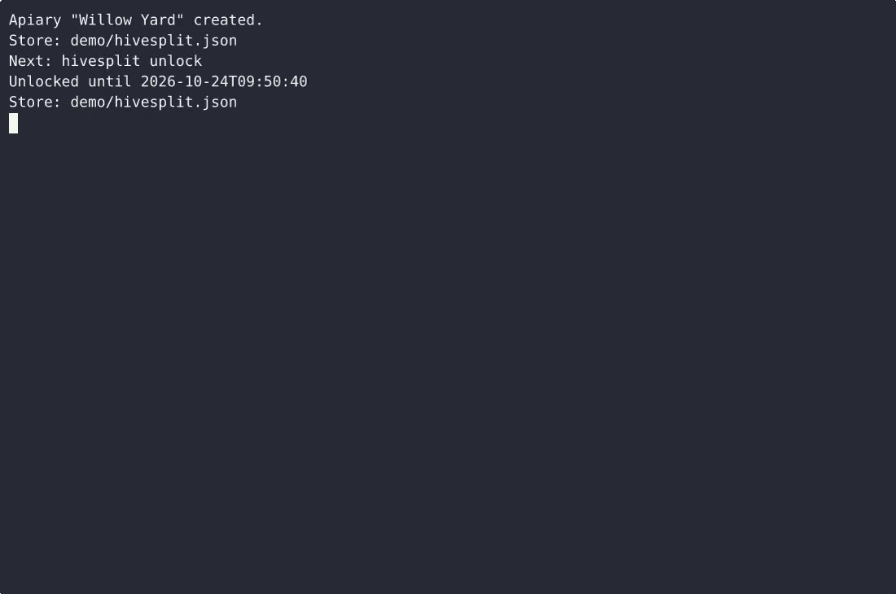
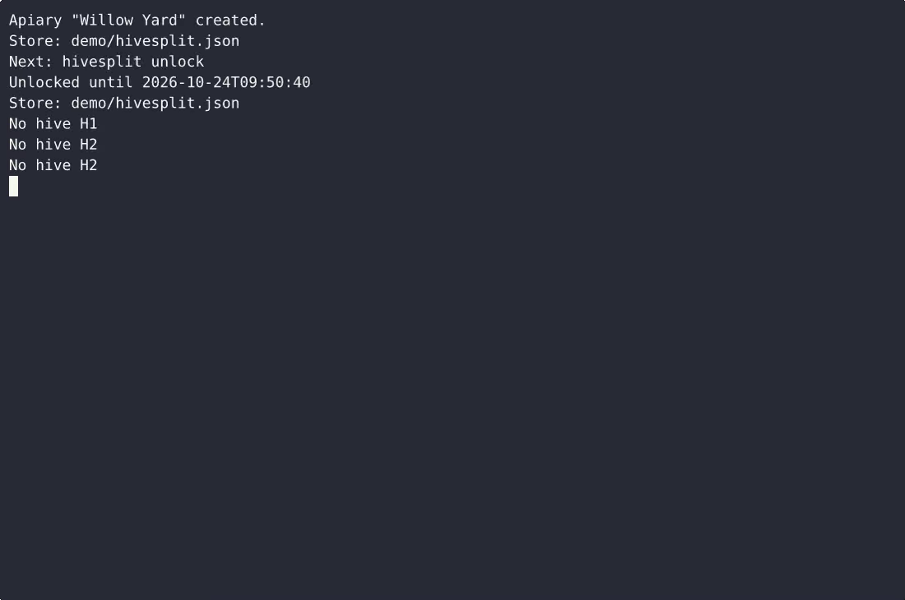

# HiveSplit — complete Full-stack app command-line tool example app

Want to run your own command-line tool without paying for SaaS? **HiveSplit** is a free, Apache-2.0-licensed Full-stack app project that you can clone and self-host today. HiveSplit is a single-file, standard-library-only Python CLI that keeps a beekeeper's apiary genealogy in one local JSON file: it logs hives, records every split as an append-only parent→child edge you can render as a…. Every HiveSplit feature — every screen, every seed record — is here. [Open HiveSplit on cenius.ai](https://cenius.ai/marketplace/p/hivesplit?ref=gh&utm_campaign=hivesplit-webapp) to modify it without writing code.


[](LICENSE)  [](https://cenius.ai)

[](https://cenius.ai/marketplace/p/hivesplit?ref=gh&utm_campaign=hivesplit-webapp)

> **▶ [Open & edit in cenius.ai](https://cenius.ai/marketplace/p/hivesplit?ref=gh&utm_campaign=hivesplit-webapp)** — one click to an editable workspace: describe changes in plain English, get an instant preview, one-click deploy and host. Modifications made on the platform come with full rebrand & relicense rights.

_Local clone? See [Quick start](#quick-start) below. cenius.ai is the zero-setup path._

## Demo


▶ **[Watch the full demo video](https://cenius.ai/marketplace/p/hivesplit?ref=gh&utm_campaign=hivesplit-webapp)** — the complete walkthrough, playing on the project's cenius.ai page · [MP4 file](.github/media/demo.mp4)

## Screenshots

 

## Quick start

```bash
./install.sh   # installs dependencies + seeds demo data
```

See [`INSTALL.md`](INSTALL.md) for full setup and usage instructions.

## Usage guide

Every example below is copy-pasteable. `hivesplit` and `python3 hivesplit.py`
are interchangeable; the examples use the bare command.

Set-up once:

```bash
hivesplit init --apiary "Willow Yard"   # passphrase prompted twice, hidden
hivesplit unlock                        # Unlocked until <time>
```

Write commands (`hive add`, `hive status`, `split`, `queen add`,
`inspect add`, `export`) refuse to run while locked:

```
$ hivesplit hive add --label H9
Locked — run hivesplit unlock
```

Read commands (`hive list`, `hive show`, `tree`, `queen list`, `queen show`,
`inspect list`, `risk`, `status`) work at any time.

---

### 1. The apiary roster

```bash
hivesplit hive add --label H1 --kind production --yard North --established 2024-04-01
hivesplit hive list
```

```
ID  LABEL  KIND        YARD   STATUS
--  -----  ----------  -----  ------
H1  H1     production  North  active
```

* Kinds: `production`, `nuc`, `split`. A label must be unique.
* `hive show H1` prints the detail block: yard, established date, status, the
  current queen, the parent split and the children with split dates, and the last
  inspection (`No inspections yet` when there is none).
* `hive status H1 merged` retires a hive without touching its history.
  Statuses: `active`, `sold`, `dead`, `merged`.
* Hives can be addressed by id (`H1`) or by label (`Willow-01`).

Empty apiary:

```
$ hivesplit hive list
No hives yet — add one with: hivesplit hive add --label <name>
```

### 2. Splits and the lineage tree

One command creates the child hive **and** its parent edge:

_Full guide: [`USAGE.md`](USAGE.md)_

## Features

- Hive registry
- Split recording and genealogy tree
- Queen production log
- Typed inspection notes
- Swarm risk score
- Local keeper passphrase gate
- Store and input validation
- Export
- Queen dam lines
- Inspection cadence reminders

## Architecture

Folder layout: `hivesplit.egg-info/`, `tests/`. `./install.sh` gets you from a fresh clone to a running instance with sample data in a single step. Built in Full-stack app (18 files). See [`INSTALL.md`](INSTALL.md) for complete setup instructions.

## FAQ

### How do I run HiveSplit on my own server?

`git clone` + `./install.sh` gets you a running instance — the install script provisions dependencies and demo data. Full steps live in [`INSTALL.md`](INSTALL.md); nothing external is needed to try it.

### Can non-developers customise HiveSplit?

Open it on [cenius.ai](https://cenius.ai/marketplace/p/hivesplit?ref=gh&utm_campaign=hivesplit-webapp) and describe the changes you want in plain English — the platform modifies the app and gives you a new, downloadable build.

### What technologies are in HiveSplit's stack?

HiveSplit runs on Full-stack app. This repo holds the full production source: you can inspect every part of it before deploying. Highlights include inspection cadence reminders.

### Can I build a business on HiveSplit?

Confirmed free for commercial use — MIT terms let you incorporate, resell, or ship it in any product. [LICENSE](LICENSE).

### Can I rebrand or white-label HiveSplit?

Yes — and the easiest way is [remixing it on cenius.ai](https://cenius.ai/marketplace/p/hivesplit?ref=gh&utm_campaign=hivesplit-webapp): modifications made on the platform come with full rebrand and relicense rights over your derivative.

## License & rebranding

Released under the [Apache License 2.0](LICENSE) (© 2026 Cenius AI) — free for personal and commercial use. The Cenius name/logo are trademarks (see NOTICE).

**Need a customized version?** [Remix this app on cenius.ai](https://cenius.ai/marketplace/p/hivesplit?ref=gh&utm_campaign=hivesplit-webapp) — modifications made on the platform come with **full rebrand & relicense rights** over your derivative.

## Built with cenius.ai

This entire application — code, design, seeded demo data — was generated on **[cenius.ai](https://cenius.ai)** from a plain-English description.

- 🚀 [Build your own app on cenius.ai](https://cenius.ai)
- 🎛️ [Remix HiveSplit on the marketplace](https://cenius.ai/marketplace/p/hivesplit?ref=gh&utm_campaign=hivesplit-webapp) — open it in a workspace, prompt for changes, and ship your own version.

More open-source apps: [the Cenius-ai catalog](https://github.com/Cenius-ai) · [showcase index](https://github.com/Cenius-ai/showcase)
